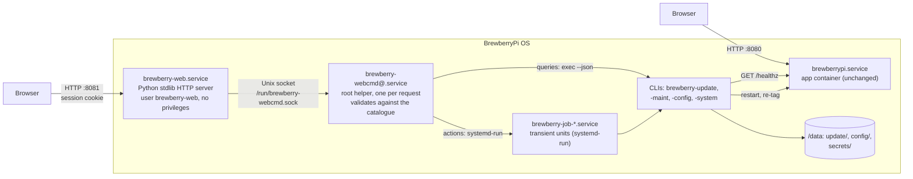

# Device web interface: architecture and design

**Status:** decided in [ADR-0002](adr/0002-device-web-interface.md) and implemented in milestone OS9
([implementation plan](implementation-plan.md)); the on-device check is `tests/hardware/os9-check.sh`.
How to use it: [user manual](user-manual.md#4-logging-in). How to add a command:
[developer guide](development.md#add-or-change-an-operator-command-cli--web-parity).

## Contents

1. [Goal and requirements](#1-goal-and-requirements)
2. [Principle: one implementation, two front ends](#2-principle-one-implementation-two-front-ends)
3. [Components](#3-components)
4. [The command catalogue](#4-the-command-catalogue)
5. [CLI changes](#5-cli-changes)
6. [Jobs: long-running actions](#6-jobs-long-running-actions)
7. [Accounts, login and passwords](#7-accounts-login-and-passwords)
8. [HTTP API](#8-http-api)
9. [User interface](#9-user-interface)
10. [Parity enforcement](#10-parity-enforcement)
11. [Security](#11-security)
12. [Tests](#12-tests)
13. [What does not change](#13-what-does-not-change)
14. [Wi-Fi setup and the captive portal (OS11)](#14-wi-fi-setup-and-the-captive-portal-os11)
15. [Update notice (OS14)](#15-update-notice-os14)

## 1. Goal and requirements

Today the Pi is managed over SSH with root commands (`brewberry-update`,
`brewberry-maint` and a few plain Linux commands in the [user manual](user-manual.md)). The device
web interface offers **the same functions in a browser**, next to the app's own web UI.

Requirements (product owner, 2026-10-15):

| ID | Requirement |
|---|---|
| WEB-01 | The web interface offers every command that the user manual documents, with the same behaviour as the CLI. |
| WEB-02 | CLI and web interface keep offering the same functions in future. A command that exists in only one of them is a defect. |
| WEB-03 | It runs in parallel to the app's web UI: the app keeps port 8080 (and port 80, ADR-0006), the device web interface listens on **port 8081** (`http://<hostname>.local:8081/`). |
| WEB-04 | No anonymous access. The login page shows the fixed user name `brewberry`; only the password is entered. |
| WEB-05 | The image has the system user `brewberry` with the default password `pi`, an administrator (passwordless `sudo`) like a user created by Raspberry Pi Imager. |
| WEB-06 | The web interface can change the password. The CLI has no command for it: `passwd` is the Linux way. Both changes survive a reboot. |
| WEB-07 | While the default password `pi` is in use, the web interface shows a reminder. It never forces a change. |
| WEB-08 | Actions that restart the app warn when a brew is loaded or running, and go ahead after confirmation. The CLI behaves exactly the same. |

## 2. Principle: one implementation, two front ends

The web interface contains **no device logic**. Every action runs the same CLI command a user types
over SSH, and every view shows that command's own `--json` output. The CLIs remain the single
implementation; the web interface is a second front end over them.

This keeps the behaviour identical by construction:

- checks, signature policy, soak, rollback, locks and safety measures run in one place;
- the confirmation and warning texts come from the CLI (§5.3), and the web interface only displays
  them;
- a bug fixed in a CLI is fixed in the web interface too.

The one function without a `brewberry-*` command is the password change: its CLI counterpart is
the standard `passwd`. It is declared as such in the catalogue (§4).

## 3. Components



| Component | Runs as | Job |
|---|---|---|
| `brewberry-web.service` | system user `brewberry-web`, `NoNewPrivileges=`, `ProtectSystem=strict`, `PrivateTmp=`, no capabilities | Serves the page and the JSON API on port 8081, checks sessions and request origins, forwards each request over the Unix socket. Keeps sessions in memory only. |
| `brewberry-webcmd.socket` | root-owned socket `/run/brewberry-webcmd.sock`, mode `0660`, group `brewberry-web`, `Accept=yes` | Starts one helper instance per request. |
| `brewberry-webcmd@.service` | root, `StandardInput=socket` | `helper.py`: reads one JSON request, checks it against the command catalogue and runs the CLI **without a shell**: queries directly, actions as a job (§6). Also checks and changes the password (§7). |
| `brewberry-job-<id>.service` | root, transient unit from `systemd-run --collect` | Runs one action with `--yes`. Survives a closed browser and a restart of the web server. |

**Why two processes:** the HTTP server faces the LAN and parses untrusted input, so it has no
privileges. The root side accepts only commands that are in the catalogue, with arguments that
match the catalogue's patterns. A compromised web process can at most run catalogue commands, as
a logged-in user can; it cannot get a root shell, read the registry token or write files.

**Why not other options** (see [ADR-0002](adr/0002-device-web-interface.md)): a web server running
as root would expose the HTTP parser with full privileges; `sudo` rules are blocked by
`NoNewPrivileges=`; polkit would add a package and a rule language for what one small socket
service does; Cockpit is large, generic and can't present the BrewberryPi commands.

**Layer `brewberry-web`** (requires `brewberry-update` and `brewberry-readonly`):

- packages: `python3` (on the image today only as a cloud-init dependency, so it is listed
  explicitly), `curl` (the brew warning reads `/healthz`);
- `/usr/lib/brewberry-web/`: `server.py`, `helper.py`, `index.html` (self-contained: no CDN, the Pi
  may be offline);
- `/usr/share/brewberry/commands.json`: the command catalogue (§4);
- units: `brewberry-web.service`, `brewberry-webcmd.socket`, `brewberry-webcmd@.service`,
  `brewberry-passwd-persist.path`/`.service`, `brewberry-passwd-restore.service` (§7);
- `/etc/avahi/services/brewberry-web.service`: announces `_http._tcp` on port 8081, so the device
  appears in browsers' and routers' service lists;
- a system user `brewberry-web` (no login shell, no home).

Python with the standard library only, like the contract stub (`stub/brewberrypi-stub.py`), whose
`ThreadingHTTPServer` and test approach are reused. Memory use stays small enough for a Pi 3 next
to the app (app `NFR-052`).

## 4. The command catalogue

`/usr/share/brewberry/commands.json` is the **single source of truth** for what an operator can do.
The helper accepts only its entries, the web interface builds its buttons from it, and the parity
test (§10) checks the CLIs and the user manual against it.

```json
{
  "version": 1,
  "commands": [
    {
      "id": "update.install", "title": "Install", "screen": "versions",
      "argv": ["brewberry-update", "install", "{version}"],
      "args": { "version": "^[0-9]+\\.[0-9]+\\.[0-9]+(-(alpha|beta|rc)\\.[0-9]+)?$" },
      "kind": "action", "confirm": true, "job": true
    },
    {
      "id": "account.password", "title": "Change the password", "screen": "account",
      "kind": "action", "webOnly": "passwd",
      "reason": "Linux's own passwd is the CLI counterpart; brewberry-passwd keeps the change across reboots for both."
    }
  ]
}
```

Fields: `id`; `title`; `screen`; `argv` with `{placeholders}`; `args` with an anchored pattern per
placeholder; `kind` (`query` or `action`); `confirm` (asks first, §5.3); `job` (runs as a transient
unit, §6); `reboots`; `timeout` (seconds, default 60); `stdin` (a secret passed on standard input,
the registry token, Wi-Fi passwords); `stdinOptional` (an empty line is allowed: an open
network or hotspot); `upload` (`{upload}` becomes the uploaded files, §8); `download` (the file
name of a query's raw output); `webOnly` with its CLI counterpart and a `reason`, for the declared
exceptions.

### Commands per screen

Every command of the user manual's command reference, plus the ones its other sections use:

| Screen | Catalogue ids → CLI | Notes |
|---|---|---|
| Overview | `update.status` (with its *Update* row, ADR-0007), `system.info` + `maint.status` (one card, *OS*), `wifi.status` | `system.info` is new (§5.4): replaces `cat /etc/brewberry-release` and adds hostname, addresses, uptime, `/data` usage |
| App versions | `update.list`, `update.download <version>`, `update.install <version>`, `update.remove <version>`, `update.rollback`, `update.demo on\|off`, `update.restart` | `restart` is new (§5.4): replaces `systemctl reset-failed` + `restart brewberrypi`. The list marks the versions on the Pi; a row offers Download (only in the registry), Install (on the Pi) or Remove (on the Pi, neither active nor previous), with a spinner while a download or install runs (ADR-0001, amended 2026-10-20). The update notice (ADR-0007, §15) adds a card at the top with Download or Install of the offered version |
| Registry | `update.login` | gets non-interactive input (§5.4) |
| Configuration | `config.show`, `config.import <upload>`, `config.export` | new CLI `brewberry-config` (§5.4): replaces the manual's SSH steps (`jq`, `cp`, `sync`, `mv`) and `scp -r` backup |
| OS update | `maint.on`, `maint.off`, `maint.upgrade` | `upgrade` is new (§5.4): replaces `apt update && apt full-upgrade`; only in maintenance mode |
| Wi-Fi | `wifi.status`, `wifi.scan`, `wifi.add <ssid>`, `wifi.forget <ssid>`, `wifi.country <code>`, `wifi.hotspot-password` | OS11 (§14); `wifi.status` is on the overview too |
| Logs | `system.logs <app\|safemode\|firstload\|update\|outputs-off\|web\|share\|wifi>` | new (§5.4): replaces the manual's `journalctl` lines |
| Account | `account.password` | `webOnly`: CLI counterpart is `passwd` |

## 5. CLI changes

The CLIs get one machine interface that both front ends use. Human output stays as it is today
where possible.

### 5.1 Shared library

`/usr/lib/brewberry/common.sh`, sourced by every CLI and by `brewberrypi-safemode`: `log`, `die`,
`write_atomic`, `lock`, `confirm`, `engine_state`, `json_out`. It removes today's copies in each
script and makes the confirmation and warning texts identical everywhere.

### 5.2 `--json`

Every query accepts `--json` and prints one JSON object on stdout. The human output is formatted
from the same data, so the CLI and the browser show the same facts. Example, `brewberry-update
status --json`:

```json
{
  "active":   { "version": "1.2.3", "id": "3f1c…" },
  "previous": { "version": "1.2.2", "id": "9a07…" },
  "service":  "active",
  "engine":   "NoProcess",
  "last":     { "time": "…", "phase": "done", "version": "1.2.3", "message": "1.2.3 is active" },
  "safemode": null,
  "demo":     false,
  "update":   { "latest": "1.3.0", "available": true, "onPi": false, "firstInstall": false, "checked": "…", "tried": "…", "error": null }
}
```

Errors keep going to stderr with a non-zero exit code; the helper returns stderr with the result,
and the web interface shows it.

### 5.3 Confirmation and the brew warning (WEB-08)

Every action marked `confirm` in the catalogue follows one protocol, in the CLI:

1. Validate the arguments (a bad version fails before any question).
2. Build the prompt. `engine_state` reads `GET http://127.0.0.1:<server.port>/healthz`, with
   `server.port` from `/data/config/app/config.json` (default 8080) and a 2 s timeout:
   - engine not `NoProcess`: "**A brew is loaded or running (engine: Running). This ends it.**"
     followed by what the action does;
   - engine `NoProcess`, or the app is down or not answering: only what the action does, for
     example "This installs 1.2.3 and restarts the app."
3. Then:
   - with `--yes`: go ahead;
   - on a terminal: print the prompt and read `yes`;
   - otherwise: print the prompt (as `{"confirm": "<prompt>"}` with `--json`) and exit with code
     **10**, "confirmation needed".

The web interface calls the command without `--yes`, shows the returned prompt in a dialog, and on
**Confirm** calls it again with `--yes`. It is a warning, never a refusal, on both sides.

This applies to `update install|rollback|demo|restart` and `maint on|off|upgrade`. A config import restarts nothing (the app reads `config.json` at start
and its recipes whenever they change), so it doesn't ask; after a new `config.json` it ends with
the hint to restart the app. `brewberry-wifi forget` asks
only for the network the Pi is connected to, and without the brew warning (`confirm --no-brew`):
it drops the browser's connection, not the app. A confirmed action that is not a job gets `--yes`
from the helper the same way.

**Behaviour change:** `brewberry-update install`, `rollback` and `demo`
now ask for confirmation, as `brewberry-maint` already does. Scripts and
`tests/hardware/os4-check.sh` pass `--yes`.

### 5.4 New subcommands

| Command | Replaces in the manual | What it does |
|---|---|---|
| `brewberry-update restart` | `systemctl reset-failed brewberrypi; systemctl restart brewberrypi` | Restarts the app; reports a configuration error (exit 2/3) like `install` does |
| `brewberry-update login --username <u> --password-stdin` | interactive `login` (still works) | Non-interactive form for the web interface; the token is read from stdin and never appears in an argument list or log |
| `brewberry-config show` | `cat /data/config/app/config.json` | `config.json` and the recipe ids (`--json`) |
| `brewberry-config import <source>` | the SSH steps in "Configuration → Over SSH" | A folder (`*.json`, `recipes/`), one `.json` file or an export `.tar.gz` (only plain files, no absolute or `..` paths): the checks, backup (in `/data/config/os/backup`) and atomic writes; recipes are replaced file by file inside `recipes/`, which the app watches (ADR-0005) |
| `brewberry-config export` | `scp -r …:/data/config/app` | Writes a `.tar.gz` of `/data/config/app` to stdout |
| `brewberry-maint upgrade` | `apt update && apt full-upgrade` | Refuses unless in maintenance mode; runs non-interactively (`-y`, keeps changed config files); logs to the job |
| `brewberry-system info` | `cat /etc/brewberry-release` | OS release, hostname, addresses, uptime, `/data` usage |
| `brewberry-system logs <name> [--lines N]` | the `journalctl -u … -b` lines in "Troubleshooting" | Current boot's journal of `app`, `safemode`, `firstload`, `update` (ADR-0007), `outputs-off`, `web`, `share` or `wifi` |

`systemctl`, `journalctl` and `apt` keep working as before; the manual then shows the
`brewberry-*` command first.

## 6. Jobs: long-running actions

An install can take minutes (pull, then a 60 s soak). Actions marked `job` therefore don't run
inside the request:

1. The helper starts `systemd-run --unit=brewberry-job-<id> --collect helper.py --job <id> --
   <argv> --yes` and returns the job id at once (`202`). Inside the unit, the helper runs the CLI,
   copies its output to `/run/brewberry-jobs/<id>.log` (and the journal) and writes the exit code
   to `<id>.exit` at the end. While one job runs, the helper refuses another (`423`).
2. The web interface polls `GET /api/jobs/<id>`: `running`, `done`, `failed` (with the exit code)
   or `lost` (the unit ended without a result, for example a reboot), plus the log.
3. A closed browser or a restarted web server doesn't interrupt the job. The overview lists the
   running job, so any browser can follow it.
4. The existing lock `/run/brewberry-update.lock` keeps a web job, a CLI command and safe mode from
   running at the same time, and the helper starts no second job while one runs.
5. Actions that reboot (`maint on|off`) show a "rebooting" page that reconnects when the Pi is back.

Job units and their logs live in RAM (volatile journal); a reboot clears them. The result of the
last install or rollback stays in `/data/update/state.json`, as today.

## 7. Accounts, login and passwords

### 7.1 The user `brewberry` (WEB-05)

`config/brewberrypi-base.yaml`:

`config/brewberrypi-base.yaml` keeps `user1: brewberry` with `user1sudo: nopasswd`.
- rpi-image-gen can't take `pi` (`user1pass` enforces strong passwords; a `$`-laden hash in the
  config would be expanded), so the `brewberry-web` layer sets it with `chpasswd` at build time.
  cloud-init keeps it (`lock_passwd: false` for its default user) and doesn't set an existing
  account's password from Imager, so Imager creates its own user next to `brewberry`.
- SSH stays key-only unless Imager enables password logins
  (`sshd_config.d/90-brewberry.conf`), so `pi` does not open SSH by default.

### 7.2 Passwords that survive a reboot (WEB-06)

The root is an overlay with a RAM upper layer, so today `passwd` changes `/etc/shadow` only until
the next reboot. Two units fix this for `passwd` and the web interface alike:

- `brewberry-passwd-persist.path` (`PathChanged=/etc/shadow`) starts a service that runs
  `brewberry-passwd persist`: it writes the hashes of the login users (UID 1000–59999) that changed
  to `/data/secrets/shadow.d/<user>`, mode `0600`, atomically (temp file, fsync, rename).
- `brewberry-passwd-restore.service` (after `data.mount`, before `ssh.service` and
  `brewberry-web.service`) runs `brewberry-passwd restore`, which applies the hashes that differ
  with `usermod -p`. That changes only the RAM layer,
  so the rule "never write to root at runtime" holds.

### 7.3 Web login (WEB-04)

- The login page shows `brewberry` as fixed text and one password field.
- The helper checks the password against `/etc/shadow` with the system's `crypt()` (libcrypt via
  `ctypes`; Python 3.13 has no `crypt` module).
- On success the web server creates a session: a random 256-bit token in a cookie with
  `HttpOnly`, `SameSite=Strict` and `Path=/`, kept in memory, expiring after 30 minutes without
  activity. A web server restart logs everyone out.
- After 5 failed logins from an address, each further attempt waits longer (1 s, doubling, up to
  60 s); until then the server answers `429`.
- Every request except the login page and its assets needs a session (`401` otherwise).

### 7.4 Password change (WEB-06) and the reminder (WEB-07)

- **Account** screen: current password, new password twice; at least 8 characters; the helper sets
  it with `chpasswd` (yescrypt). The persistence unit (§7.2) saves it to `/data`. `chpasswd` goes
  through PAM, so the file share's hook sets the share's password too (ADR-0003).
- After each login the helper checks whether the hash still matches `pi`. If it does, every screen
  shows: "You are using the default password. Change it under *Account*." Everything keeps working;
  the change is never forced.

## 8. HTTP API

All JSON. Every `POST` must carry the header `X-Brewberry: 1`, and its `Origin` (if sent) must match
`Host` (§11). `GET /api/session` (`{user, loggedIn, defaultPassword}`) and the page itself need no
session.

| Request | Response |
|---|---|
| `POST /api/login` `{password}` | `200` + session cookie, `{defaultPassword: bool}`; `401` |
| `POST /api/logout` | `204` |
| `POST /api/password` `{old, new}` | `204`; `400` (too short), `401` (old wrong) |
| `GET /api/commands` | the catalogue, without `argv` |
| `GET /api/run/<id>?<arg>=…` (queries) | `200 {output}` (the CLI's JSON); `422 {error}` |
| `POST /api/run/<id>` `{args, yes}` (actions) | `409 {confirm}` (needs confirmation), `202 {job}` (job started), `200 {output}`, `422 {exit, stderr}` (the CLI failed), `423 {job}` (another job runs) |
| `GET /api/jobs/<id>` | `{id, cmd, started, state, exit, log}` |
| `GET /api/jobs` | the last 10 jobs, without logs |
| `POST /api/run/config.import` `{files: [{name, data}]}` | as above; `data` is base64, `name` is `<x>.json`, `recipes/<id>.json` or one `.tar.gz`; at most 8 MiB in all. Staged in `/data/tmp/web-upload/<random>/`, handed to `brewberry-config import` (which checks every file, max 1 MiB each) and deleted |
| `GET /api/run/config.export` | `application/gzip` download |

## 9. User interface

One page, no build step: vanilla JavaScript and inline CSS in `index.html`, light and dark following
the browser, in the BrewberryPi brand (`tinkerius/brewberrypi`, `brand/README.md`): paper
background, ink text, berry for actions and links, brass for warnings, leaf for success, and
Zilla Slab Medium for headings. It looks like the app's UI (`tinkerius/brewberrypi-app`,
`frontend/src/ui.ts`): the same white top bar with the side-by-side logo, white cards with a
faint ring and shadow, ink card titles, berry primary and neutral secondary buttons, the same
fields and dialogs, and Tailwind's stone greys and red. The stub's "app not installed" page uses
the same look. English, like the app.

- **Brand files** in `/usr/lib/brewberry-web/static/`: the logos (side by side and stacked, each
  for light and dark), the favicons, the touch icon and a Latin subset of Zilla Slab Medium (OFL).
  They are copies made by `scripts/sync-brand.sh`; don't edit them by hand. The server sends only
  these files, by a fixed list and without a login (the login page shows the logo), so the page
  needs nothing from the internet.
- **Header:** the logo with "OS", hostname, OS version, user `brewberry`, **Log out**; a link to the
  app's UI (`http://<host>:<server.port>/`). The login page shows the stacked logo.
- **Banner** for the default password (§7.4) and for a running job.
- **Screens** as tabs, matching §4: Overview, Wi-Fi, App versions (with Registry), Configuration,
  OS update, Logs, Account. (The USB stick screen was removed with ADR-0005.)
- Buttons carry the catalogue id (`data-cmd="update.install"`), which the parity test reads.
- Confirmation dialog shows the CLI's prompt text verbatim (§5.3); the brew warning appears in bold.
- The OS update screen repeats the manual's warning: the power must stay connected from
  maintenance mode on until it is off again.

## 10. Parity enforcement

WEB-02 is enforced by a test, not by discipline alone. `tests/unit/parity.sh`, run by
`scripts/lint.sh` and therefore by CI, fails if any of these differ:

1. **CLI ↔ catalogue:** the subcommands in each CLI's usage header and dispatcher, and the
   catalogue entries that name that CLI.
2. **Catalogue ↔ web:** the catalogue ids, the `data-cmd` ids in `index.html`, and the ids the
   helper accepts.
3. **Catalogue ↔ manual:** the commands in the user manual's command reference and the catalogue.

Declared exceptions (`webOnly`, for example the password change) must name their CLI
counterpart. A new CLI command without a web control, or a web feature without a CLI command, is
therefore a red CI run. `CLAUDE.md` states the rule for contributors: change the CLI, the catalogue,
the web interface and the manual in one change.

## 11. Security

| Threat | Measure |
|---|---|
| Anonymous use on the LAN | Login required for everything (WEB-04); rate-limited login |
| Another web page in the user's browser triggers actions (CSRF, app `Q-17`) | `SameSite=Strict` cookie, `Origin` must equal `Host`, custom header on every `POST` |
| DNS rebinding | `Host` must be the Pi's hostname, `<hostname>.local`, one of its IP addresses, or `localhost` |
| Command injection | Catalogue only; anchored argument patterns; no shell anywhere (`argv` lists); uploads staged under a generated name |
| A compromised web server | It runs unprivileged and can only send catalogue requests over the socket |
| Weak default password | Reminder banner (WEB-07); SSH stays key-only by default |
| Downgrades | Allowed, as on the CLI: only signed versions install, and only logged-in users can ask. This answers ADR-0001's open question for the web interface. |
| **Plain HTTP** | Passwords, session cookies and the registry token cross the LAN unencrypted, as with the app (app `IF-060`). Accepted for a home LAN; TLS with a self-signed certificate is a follow-up. |

Safety is unchanged: the web interface only runs the CLIs, which keep the outputs-off reset,
watchdogs, signature policy and `/data`-only writes.

## 12. Tests

- **Unit (host, `scripts/lint.sh`):**
  - Python `unittest` for `server.py` and `helper.py`, modelled on `stub/test_stub.py`: the server
    as a subprocess on a free port, fake CLIs and a fake `systemd-run` on `PATH`, a fake shadow
    file. Covers login and sessions, `401` without a session, `Origin`/`Host` checks, rejection of
    unknown ids and bad arguments, the `409` → confirm → `202` flow, jobs and uploads.
  - Shell tests (`tests/unit/update.sh`, `maint.sh`, new `config.sh`, `system.sh`): `--json`
    output, `--yes`, exit code 10, the brew warning with a fake `curl`.
  - `tests/unit/parity.sh` (§10).
- **Hardware:** `tests/hardware/os9-check.sh`:
  - port 8081 answers, every API call without a session gets `401`;
  - an install started in the browser gives the same `brewberry-update status` as one from the CLI;
  - restarting `brewberry-web` during an install doesn't interrupt it;
  - with the stub reporting `Running`, the CLI and the web interface show the same warning;
  - a password changed in the web interface, and one changed with `passwd`, survive a reboot;
  - the reminder disappears after the change.

## 13. What does not change

- The **runtime contract** (version 1) and the app repository. The app's open question `Q-16`
  ("update from the web UI") can be answered there with: not part of the app; the OS's device web
  interface on port 8081 does it.
- The app container: no `/update` mount, no access to the registry token.
- Safety measures, `policy.json` and the image tags `active` and `previous`.

## 14. Wi-Fi setup and the captive portal (OS11)

[ADR-0004](adr/0004-wifi-setup-hotspot.md): without a reachable home network the Pi opens the
hotspot `<hostname>` at `10.42.0.1`, and the device web interface is how the user sets up Wi-Fi
over it.

- **Port 80** (`brewberry-portal.socket` → `portal.py`, layer `brewberry-wifi`, user
  `brewberry-web`, unprivileged like the web server): answers every request with a redirect. On
  the hotspot, NetworkManager's dnsmasq resolves every name to `10.42.0.1`
  (`dnsmasq-shared.d/brewberry-portal.conf`), so the captive-portal checks of phones and computers
  get `302 http://10.42.0.1:8081/#wifi` and open the Wi-Fi screen. A request for the Pi's own name
  or an IP address goes to the same host on port 8081. Off the hotspot, port 80 is forwarded to the app (ADR-0006).
- **No change to the server's checks:** the page is opened by IP address, which the `Host` check
  already accepts, and the login stays as it is.
- **The Wi-Fi screen** runs `wifi.status`, `wifi.scan` (while the hotspot is up the Wi-Fi can't
  scan: the service's last scan is shown, marked `cached`), `wifi.add` (password on stdin, empty
  for an open network), `wifi.forget` (buttons per network), `wifi.country` and
  `wifi.hotspot-password` (empty: open). The texts after saving come from the CLI: where to find the
  Pi once it has left the hotspot.
- **On an open hotspot** the app's port is closed by the service's nftables rule, so the header's
  link to the app doesn't work there; the Wi-Fi screen says so in a banner.

## 15. Update notice (OS14)

[ADR-0007](adr/0007-first-install-and-update-notice.md). `brewberry-update status --json` has
`update: {latest, available, onPi, firstInstall, checked, tried, error}`, from the last registry answer
(`/data/update/tags.json`, written by `brewberry-update list`, which `brewberry-update-check.timer`
runs every 6 hours, and at every run while no app is installed). The CLI decides which version is
offered and whether it is newer; the page only shows it:

- **Top bar** (every screen): a pill *Update: 1.3.0* (no app installed: *Installing the app 1.3.0*),
  a link to `#versions`. No pop-up.
- **Tab** *App versions*: a dot.
- **App versions**: a card at the top with the active and the offered version and one button,
  *Download 1.3.0* (`update.download`) or, once `onPi`, *Install 1.3.0* (`update.install`, with the
  CLI's confirmation and brew warning). While the first install runs (`last.phase` downloading or
  switching for that version), its progress instead of the button. A failed last try is named.
- **Overview**, card *App*: a row *Update* (available, up to date, or why the last check failed).

The page reads `update.status` when a screen loads and every 5 minutes while logged in, without a
message when the Pi doesn't answer. No new catalogue entry: the check is `update.list` (*Check the
registry*), and its log `system.logs update`.

